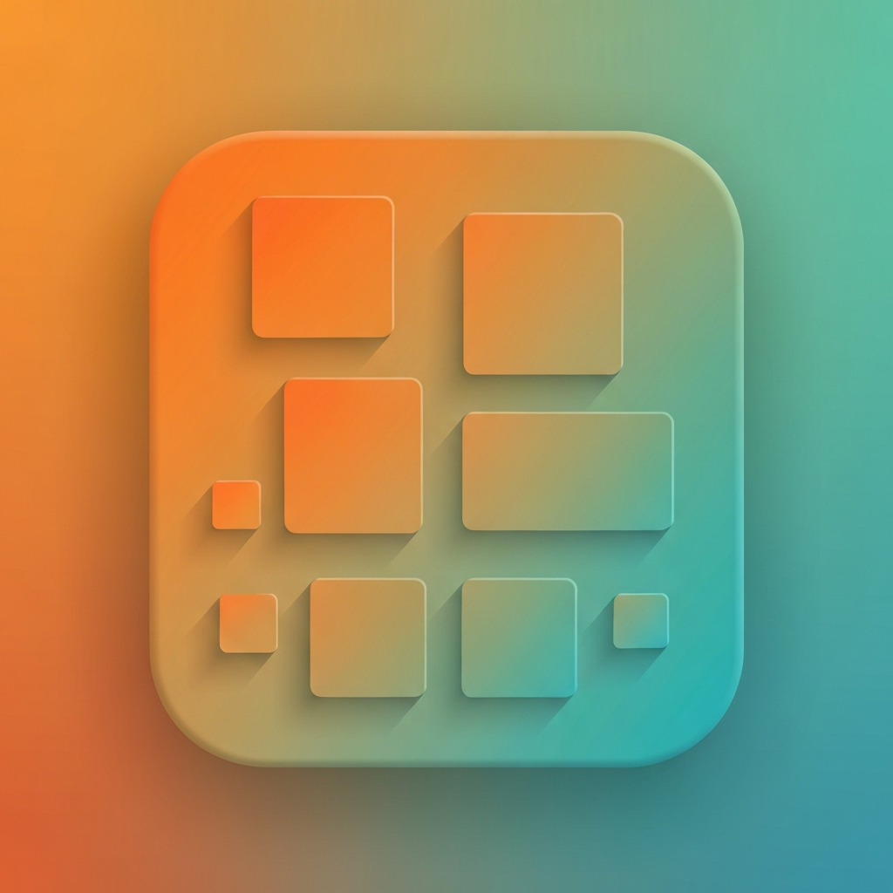

<p align="center">
  
</p>

<h1 align="center">Image Asset Manager</h1>

<p align="center">A native macOS app for AI image generation, asset management, and consulting workflow integration.</p>

---

> **Status:** v1.1.0 in preparation for the Mac App Store (1.0.1 is the current release). The App Store release is macOS only.

## What it is

Image Asset Manager brings the discipline of a proper asset library to AI image generation. Every prompt, variant, project, and pound spent is tracked, organised, and retrievable later. Built for designers, brand consultants, and creative directors who use AI imagery in client work.

It is a SwiftUI app with a three-panel layout on macOS. The iPad code is kept compiling but is not shipped; iPhone is out of scope.

## Features

- **Two providers, either key alone works** — Google Gemini direct (Google AI Studio key) and OpenRouter (OpenRouter key). You ask for a quality tier (fast, standard, pro) or name a specific model; the app picks the route and falls back to the other provider when one has no key, doesn't know the model or has no credit
- **A remote model catalogue** — which models each tier uses, their prices and retired names live in a file the app refreshes by itself, so model changes need no app release
- **Raster and vector assets** — PNG, JPEG, WebP and SVG, with SVG previews drawn from a sanitised copy
- **Per-generation budget guardrails** in GBP — overspend protection enforced before the API call is made, and every paid call recorded in the spend log, kept or not
- **Reference images** by role (style anchor / subject anchor), up to the limit of the chosen model
- **Variant families** group iterations of the same concept so nothing ends up as an orphan generation
- **Multi-project memberships** — assets can live in multiple projects with a designated primary
- **Clients, tags, and a structured prompt library** as first-class objects
- **Spend dashboard** with Swift Charts visualisation by day, model, and project
- **iCloud Drive** sync by default, or a custom library folder of your choice
- **Local MCP server** exposes the asset library to Anthropic's Claude Code CLI on `127.0.0.1:47821`. Tools: `generate` (say what you want — media, quality, required capabilities — and the app chooses the model), `list_generation_options` (what is available now, with estimates), `generate_image` (an alias of `generate` for images), and the library tools `search_assets`, `get_asset`, `get_asset_lineage`, `list_projects`, `get_spend`, `search_prompts`, `get_prompt`, `mark_asset_used`, `upload_asset`. The read tools work from `index.json` when the app is closed

## Technology

- Swift 6 with strict concurrency throughout
- SwiftUI on macOS 26 (iPadOS 26 code kept compiling, not shipped)
- SQLite via [GRDB](https://github.com/groue/GRDB.swift) 7.x — the sole external dependency
- Swift Charts for the spend dashboard
- macOS Keychain for API key storage
- A local Swift `NWListener` HTTP server for the MCP integration
- A Node.js MCP proxy in `mcp-server/` for the Claude Code-facing side

API keys are stored only in the Keychain — never in iCloud, the library directory, or the source tree.

## Building locally

You will need Xcode 26.x and an Apple developer account configured for code signing.

```bash
git clone https://github.com/Jay-Hell/image-asset-manager.git
cd image-asset-manager
open ImageAssetManager/ImageAssetManager.xcodeproj
```

Command-line builds:

```bash
# macOS
xcodebuild -project ImageAssetManager/ImageAssetManager.xcodeproj \
  -scheme ImageAssetManager -destination 'platform=macOS' build

# iPad Pro simulator
xcodebuild -project ImageAssetManager/ImageAssetManager.xcodeproj \
  -scheme ImageAssetManager \
  -destination 'platform=iOS Simulator,name=iPad Pro 13-inch (M4)' build

# Run the Core package tests
swift test --package-path ImageAssetManager/ImageAssetManager/ImageAssetManagerCore
```

To use the app you will need:

- A Google AI Studio API key (https://aistudio.google.com/apikey), an OpenRouter API key (https://openrouter.ai/keys), or both — either alone is enough
- Optionally, an Anthropic API key for prompt refinement — https://console.anthropic.com/settings/keys

Keys are entered in the in-app **Settings** and stored in Keychain. When OpenRouter is used, prompts and reference images are sent to openrouter.ai under your own key.

## Repository layout

The repo follows a standard Xcode structure with one embedded Swift package for business logic:

- `ImageAssetManager/ImageAssetManager/` — the universal app target (SwiftUI views only)
- `ImageAssetManager/ImageAssetManager/ImageAssetManagerCore/` — embedded Swift package containing all business logic, data access, and provider abstraction (no SwiftUI imports)
- `mcp-server/` — the Node.js MCP proxy for Claude Code integration

For a detailed architectural overview — including the database schema migrations, provider abstraction, generation pipeline, and platform strategy — see [CLAUDE.md](CLAUDE.md).

## Support

- [Privacy policy](https://ionicconsulting.co.uk/image-asset-manager/privacypolicy)
- [Support and FAQ](https://ionicconsulting.co.uk/image-asset-manager/support)
- Email: john@ionicconsulting.co.uk

## Licence

Source code is published here for reference and transparency. All rights reserved by Ionic Consulting Ltd. For reuse, redistribution, or contribution enquiries, please email john@ionicconsulting.co.uk.

---

Built by [Ionic Consulting](https://ionicconsulting.co.uk).
